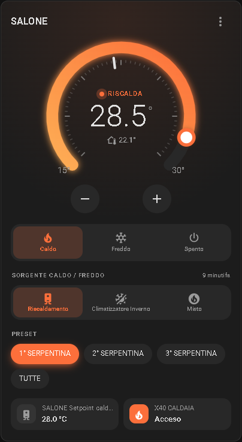
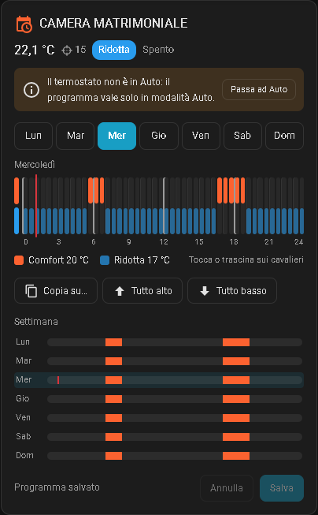

# Climate Manager

[🇮🇹 Italiano](README.md) · 🇬🇧 English

A custom integration for Home Assistant that manages heating and cooling zones: one thermostat per zone, with valves, boiler, pump, air conditioner, time slots, windows and antifreeze.

Each zone becomes a `climate` entity plus a few supporting entities, and everything is configured from the UI, with no YAML. Three dashboard cards come with the integration.

<p align="center">
  
  &nbsp;
  
</p>

## Features

- **Choice of input:** temperature sensor or physical thermostat (closed contact = heat request).
- **Outputs:** one or more valves/relays, boiler start output, pump output, air conditioner.
- **Modes:** Off, Heat, Cool (with an air conditioner) and Auto (with time slots).
- **Source:** with an air conditioner, choose between Heating, Air conditioner winter, Air conditioner summer and Mixed.
- **Presets:** choose which valves stay active (useful when a zone has several valves).
- **Boiler setpoint:** a single setpoint shared by all zones using the same boiler, with an override value.
- **Time slots (programmable thermostat):** comfort inside the slots, reduced outside. They work with the sensor and the physical thermostat, for heating and cooling.
- **Blocking calendars:** if a calendar is active, the schedule is blocked (turns off or uses the reduced temperature).
- **Windows:** if a window stays open longer than the delay, the zone is suspended.
- **Antifreeze:** below the set temperature the zone always heats, even when off.
- **Cards included:** thermostat, selector and peg-style schedule.

## Installation

### HACS
1. HACS → Integrations → ⋮ menu → **Custom repositories**.
2. Paste `https://github.com/ichnusa82/climate_manager`, category *Integration*.
3. Install **Climate Manager** and restart Home Assistant.

### Manual
1. Copy the `custom_components/climate_manager` folder into `config/custom_components/`.
2. Restart Home Assistant.

Then go to **Settings → Devices & services → Add integration** and search for **Climate Manager**.

> **Updating:** after every update restart Home Assistant and reload the browser (on tablets running Fully Kiosk, clear the cache).

## Creating a thermostat

Add the integration once **for each zone**. The form asks for:

| Field | Meaning |
|---|---|
| Name | Zone name (must be unique) |
| Relays / valves | One or more `switch` or `input_boolean` to control |
| Input type | Temperature sensor or physical thermostat |
| Temperature sensor | Any `sensor` (Modbus probes included) |
| Physical thermostat contact | `binary_sensor`, `switch` or `input_boolean` |
| Inverted contact | Enable it if an open contact means heat request |
| Boiler / pump output | Optional: turned on when the zone calls for heat |
| Air conditioner | Optional: `climate`, `switch` or `input_boolean` entity |
| Boiler setpoint | Optional: `number` or `input_number` (for example the one read by the ESP8266) |
| Override entity / Override setpoint | When the entity is on, the boiler uses the override setpoint |
| Comfort / reduced temperature | Used in Auto, when heating, inside and outside the slots (default 20 / 17 °C) |
| Summer comfort / reduced temperature | Used in Auto with Air conditioner summer (default 26 / 28 °C) |
| Blocking calendars and mode | What to do when a calendar is active |
| Window sensor / Delay | Opening sensors and minutes before suspending |
| Antifreeze temperature | Below this temperature the zone always heats. 0 = disabled |
| Enable cooling mode | Shows the Cool mode and the Air conditioner summer source (needs the air conditioner) |
| Hot / cold tolerance | Switch-on and switch-off hysteresis |
| Minimum cycle | Minimum on/off time in minutes, 0 = disabled |
| Minimum / maximum temperature | Thermostat limits (default 15 and 30 °C) |

All settings can be changed later: **Devices & services → Climate Manager → Configure**.

## Entities

Each zone's device contains:

**Controls**
- The **thermostat** (`climate`), with presets for the valves.
- **Heat - cool source:** only when an air conditioner is configured.
- **Boiler setpoint:** only when the setpoint is configured. It is shared: other zones using the same boiler create it disabled.
- A **"… enabled"** switch for each valve, when the zone has at least two. It excludes a valve without changing preset.

**Configuration (slot editor for dashboards)**
As an alternative to the schedule card, these entities manage the slots one at a time:

1. 01 Slot: picks the slot to edit, or "New slot"
2. 02–08 Slot Monday … Sunday: the days
3. 09 Slot start
4. 10 Slot end
5. 11 Save slot
6. 12 Delete slot
7. 13 Delete all slots

To create a slot: keep "New slot", turn on the days, set start and end, press **Save**. To edit one: pick it in the selector, change the values and press **Save**. If the end is before the start, the slot crosses midnight.

These entities are in the *Configuration* section and do not appear in auto-generated dashboards.

## How it works

### Modes
- **Heat:** heats towards the manually set temperature, using the chosen source.
- **Cool:** cools with the air conditioner towards the manually set temperature. Presets are hidden, because the valves are not used.
- **Auto:** follows the time slots (at least one slot is needed). Inside the slots it uses the comfort temperature, outside the reduced one. A manual change lasts until the next slot change.
- **Off:** everything stops, except antifreeze.

### Source (thermostats with an air conditioner)
| Source | What it does |
|---|---|
| Heating | Heats with the boiler system (boiler, pump, valves) |
| Air conditioner winter | Heats with the air conditioner |
| Air conditioner summer | Cools with the air conditioner |
| Mixed | Heating and air conditioner heat together |

- Switching to **Heat**, Air conditioner summer becomes Air conditioner winter; in Heat, Air conditioner summer cannot be selected.
- Switching to **Cool**, the source becomes Air conditioner summer, the only one available.
- In **Auto** any source can be chosen: with Air conditioner summer the schedule cools with the summer temperatures, with the other sources it heats.
- Air conditioner summer exists only when cooling mode is enabled. Without an air conditioner there is no cooling.

### Thermostat with a sensor
It heats when the temperature drops below the target minus the *cold tolerance* and stops when it rises above the target plus the *hot tolerance*. Cooling works the other way round. The minimum cycle prevents switching too often.

### Physical thermostat
The contact decides: the zone works when the contact calls. In Auto the contact is only followed inside the slots; outside the slots the zone stays off. The air conditioner runs in heating or cooling according to the source.

### Boiler, pump and setpoint
The boiler and the pump turn on when at least one zone calls for heat with the heating system (Heating or Mixed), never when cooling. The boiler setpoint is shared: when the override entity is on, the override setpoint is written.

### Priority
Antifreeze comes first, then open window and blocking calendar, then the normal rules.

## Dashboard cards

The cards are loaded automatically with the integration: no resources to add.

> If you previously copied `climate-manager-card.js` into `/config/www`, remove the `/local/climate-manager-card.js` resource from the dashboard and delete the file.

### Thermostat
Dial with a draggable setpoint, mode buttons, source, presets and a status row.


```yaml
type: custom:climate-manager-card
entity: climate.salone
name: Living room              # optional
show_modes: true               # optional
show_presets: true             # optional
selects:                       # optional: buttons for one or more selects
  - select.salone_sorgente_caldo_freddo
entities:                      # optional: status row
  - entity: switch.caldaia
    name: Boiler
  - binary_sensor.finestra_salone
```

### Selector
Buttons for any `select` or `input_select`, in the same style.

```yaml
type: custom:climate-manager-select-card
entity: select.salone_sorgente_caldo_freddo
```

The Source options have fixed icons: Heating `mdi:water-boiler`, Air conditioner winter `mdi:sun-snowflake-variant`, Air conditioner summer `mdi:snowflake`, Mixed `mdi:fire-circle`. Use `icons:` to pick different ones.

### Peg-style schedule


Each peg is a time interval: **up = comfort / in slot**, **down = reduced / outside slot**. Tap or drag to change them, copy a day to other days and press **Save**. A label shows AC winter or AC summer when the source is the air conditioner.

```yaml
type: custom:climate-manager-schedule-card
entity: climate.salone
step: 30          # 15, 30 or 60 minutes (optional)
show_week: true   # week overview (optional)
title: Living room  # optional
```

## `set_schedule` action

Sets all the slots of a thermostat at once (used by the schedule card):

```yaml
action: climate_manager.set_schedule
target:
  entity_id: climate.salone
data:
  slots:
    - days: [mon, tue, wed, thu, fri]
      start: "06:30"
      end: "08:30"
    - days: [sat, sun]
      start: "08:00"
      end: "22:00"
```

An end of `00:00` means midnight. The current schedule is in the thermostat's `schedule` attribute.

## Options (Configure menu)

- **Settings and valves**
- **Add / Edit / Reorder / Delete presets** (with at least two valves)
- **Add / Edit / Delete time slots**

## Languages

Italian and English, following the Home Assistant language.

## FAQ

**The boiler setpoint goes back to 28.** It is the minimum allowed value. It happens when no zone calls for heat and there is no saved value: check that the override entity and the setpoint are the right ones.

**In Auto the physical thermostat does not turn anything on.** Inside a slot the zone only works if the contact calls as well.

**I don't see the Cool mode.** An air conditioner must be configured and *Enable cooling mode* must be on.

**The card does not update after an update.** Reload the browser; on the tablet clear the Fully Kiosk cache.

**I renamed a zone and the entity IDs stayed the same.** Home Assistant does not rename existing entity IDs. Change them from the entity settings.

## Known limitations

The integration is being tested on a real system, but not yet on different setups. Please report issues in the repository.

## License

MIT
