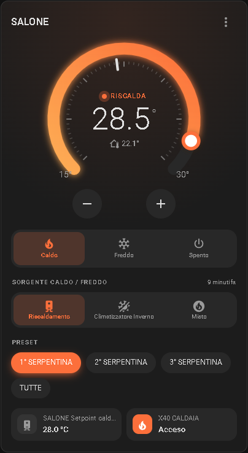
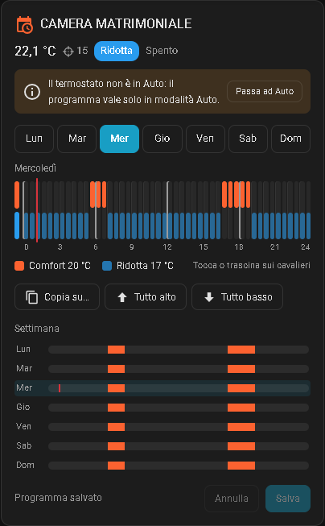

# Climate Manager

🇮🇹 Italiano · [🇬🇧 English](README.en.md)

Integrazione personalizzata per Home Assistant che gestisce le zone di riscaldamento e raffrescamento: un termostato per ogni zona, con valvole, caldaia, pompa, climatizzatore, fasce orarie, finestre e antigelo.

Ogni zona diventa un'entità `climate` più alcune entità di supporto, e si configura tutta da interfaccia, senza YAML. Con l'integrazione arrivano anche tre card per la dashboard.

<p align="center">
  
  &nbsp;
  
</p>

## Cosa fa

- **Ingresso a scelta:** sensore di temperatura oppure termostato fisico (contatto chiuso = richiesta di calore).
- **Uscite:** una o più valvole/relè, uscita di accensione caldaia, uscita pompa, climatizzatore.
- **Modalità:** Spento, Caldo, Freddo (con climatizzatore) e Auto (con fasce orarie).
- **Sorgente:** con il climatizzatore si sceglie tra Riscaldamento, Climatizzatore Inverno, Climatizzatore Estate e Misto.
- **Preset:** per scegliere quali valvole tenere attive (utile se una zona ha più elettrovalvole).
- **Setpoint caldaia:** un setpoint unico, condiviso da tutte le zone con la stessa caldaia, con valore di override.
- **Fasce orarie (cronotermostato):** comfort dentro le fasce, ridotta fuori. Funzionano con la sonda e con il termostato fisico, in caldo e in freddo.
- **Calendari di blocco:** se un calendario è attivo, il programma si blocca (spegne o usa la temperatura ridotta).
- **Finestre:** se una finestra resta aperta oltre il ritardo, la zona si sospende.
- **Antigelo:** sotto la temperatura impostata scalda sempre, anche da spento.
- **Card incluse:** termostato, selettore e cronotermostato a cavalieri.

## Installazione

### HACS
1. HACS → Integrazioni → menu ⋮ → **Repository personalizzati**.
2. Incolla `https://github.com/ichnusa82/climate_manager`, categoria *Integrazione*.
3. Installa **Climate Manager** e riavvia Home Assistant.

### Manuale
1. Copia la cartella `custom_components/climate_manager` in `config/custom_components/`.
2. Riavvia Home Assistant.

Poi vai in **Impostazioni → Dispositivi e servizi → Aggiungi integrazione** e cerca **Climate Manager**.

> **Aggiornamento:** dopo ogni aggiornamento riavvia Home Assistant e ricarica il browser (sui tablet con Fully Kiosk svuota la cache).

## Creare un termostato

Aggiungi l'integrazione una volta **per ogni zona**. Il modulo chiede:

| Campo | Significato |
|---|---|
| Nome | Nome della zona (deve essere unico) |
| Relè / elettrovalvole | Uno o più `switch` o `input_boolean` da comandare |
| Tipo di ingresso | Sensore di temperatura o termostato fisico |
| Sensore di temperatura | Qualsiasi `sensor` (anche sonde Modbus) |
| Contatto del termostato fisico | `binary_sensor`, `switch` o `input_boolean` |
| Contatto invertito | Attivalo se il contatto aperto significa richiesta di calore |
| Uscita caldaia / pompa | Opzionali: si accendono quando la zona chiede calore |
| Climatizzatore | Opzionale: entità `climate`, `switch` o `input_boolean` |
| Setpoint caldaia | Opzionale: `number` o `input_number` (per esempio quello letto dall'ESP8266) |
| Entità di override / Setpoint di override | Se l'entità è accesa, la caldaia usa il setpoint di override |
| Temperatura comfort / ridotta | Usate in Auto, in caldo, dentro e fuori dalle fasce (di default 20 / 17 °C) |
| Temperatura comfort / ridotta estate | Usate in Auto con Climatizzatore Estate (di default 26 / 28 °C) |
| Calendari di blocco e modalità | Cosa fare quando un calendario è attivo |
| Sensore Finestra / Ritardo | Sensori di apertura e minuti prima di sospendere |
| Antigelo Temperatura | Sotto questa temperatura scalda sempre. 0 = disattivato |
| Abilita modalità freddo | Mostra la modalità Freddo e la sorgente Climatizzatore Estate (serve il climatizzatore) |
| Tolleranza caldo / freddo | Isteresi di accensione e spegnimento |
| Ciclo minimo di accensione | Minuti minimi di accensione, 0 = disattivato |
| Temperatura minima / massima | Limiti del termostato (di default 15 e 30 °C) |

Tutte le impostazioni si possono cambiare dopo: **Dispositivi e servizi → Climate Manager → Configura**.

## Entità create

Per ogni zona trovi nel dispositivo:

**Controlli**
- Il **termostato** (`climate`), con i preset per le valvole.
- **Sorgente caldo - freddo:** solo se è configurato un climatizzatore.
- **Setpoint caldaia:** solo se è configurato il setpoint. È unico: le altre zone con la stessa caldaia lo creano disabilitato.
- Un interruttore **«… attiva»** per ogni valvola, se la zona ne ha almeno due. Serve a escludere una valvola senza cambiare preset.

**Configurazione (editor delle fasce da dashboard)**
In alternativa alla card cronotermostato, queste entità permettono di gestire le fasce una alla volta:

1. 01 Fascia: sceglie quale fascia modificare, oppure «Nuova fascia»
2. 02–08 Fascia Lunedì … Domenica: i giorni
3. 09 Inizio fascia oraria
4. 10 Fine fascia oraria
5. 11 Salva fascia oraria
6. 12 Elimina fascia
7. 13 Elimina tutte le fasce

Per creare una fascia: lascia «Nuova fascia», attiva i giorni, imposta inizio e fine, premi **Salva**. Per modificarne una: sceglila dal selettore, cambia i valori e premi **Salva**. Se la fine è prima dell'inizio, la fascia passa la mezzanotte.

Queste entità sono nella sezione *Configurazione* e non compaiono nelle dashboard generate in automatico.

## Come funziona

### Modalità
- **Caldo:** scalda verso la temperatura impostata a mano, con la sorgente scelta.
- **Freddo:** raffresca con il climatizzatore verso la temperatura impostata a mano. I preset non si mostrano, perché le valvole non lavorano.
- **Auto:** segue le fasce orarie (serve almeno una fascia). Dentro le fasce usa la temperatura comfort, fuori la ridotta. Se cambi la temperatura a mano, la modifica vale fino al prossimo cambio di fascia.
- **Spento:** tutto fermo, salvo l'antigelo.

### Sorgente (termostati con climatizzatore)
| Sorgente | Cosa fa |
|---|---|
| Riscaldamento | Scalda con l'impianto della caldaia (caldaia, pompa, valvole) |
| Climatizzatore Inverno | Scalda con il climatizzatore |
| Climatizzatore Estate | Raffresca con il climatizzatore |
| Misto | Scaldano insieme riscaldamento e climatizzatore |

- Passando a **Caldo**, Climatizzatore Estate diventa Climatizzatore Inverno; in Caldo Climatizzatore Estate non si può scegliere.
- Passando a **Freddo** la sorgente diventa Climatizzatore Estate, l'unica disponibile.
- In **Auto** si sceglie liberamente: con Climatizzatore Estate il programma raffresca con le temperature estive, con le altre sorgenti scalda.
- Climatizzatore Estate c'è solo se la modalità freddo è abilitata. Senza climatizzatore non si raffresca mai.

### Termostato con sonda
Scalda quando la temperatura scende sotto l'obiettivo meno la *tolleranza freddo* e si ferma quando supera l'obiettivo più la *tolleranza caldo*. Il freddo fa lo stesso al contrario. Il ciclo minimo evita accensioni troppo ravvicinate.

### Termostato fisico
Decide il contatto: la zona lavora quando il contatto chiede. In Auto il contatto è ascoltato solo dentro le fasce; fuori fascia la zona resta ferma. Il climatizzatore si accende in caldo o in freddo secondo la sorgente.

### Caldaia, pompa e setpoint
La caldaia e la pompa si accendono quando almeno una zona chiede calore con il riscaldamento (Riscaldamento o Misto), mai in raffrescamento. Il setpoint caldaia è unico: se l'entità di override è accesa, viene scritto il setpoint di override.

### Priorità
L'antigelo ha la precedenza su tutto, poi vengono finestra aperta e blocco calendario, infine le regole normali.

## Card per la dashboard

Le card si caricano in automatico con l'integrazione: non serve aggiungere risorse.

> Negli esempi sostituisci gli entity ID con i tuoi: li trovi nel dispositivo della zona, in **Impostazioni → Dispositivi e servizi → Climate Manager**. Per esempio la Sorgente della zona «Salone» è `select.salone_sorgente_caldo_freddo` con Home Assistant in italiano e `select.salone_heat_cool_source` in inglese.

> Se in passato hai copiato `climate-manager-card.js` in `/config/www`, togli la risorsa `/local/climate-manager-card.js` dalla dashboard e cancella il file.

### Termostato
Quadrante con setpoint trascinabile, pulsanti delle modalità, sorgente, preset e riga di stato.

```yaml
type: custom:climate-manager-card
entity: climate.salone
name: Salone                   # facoltativo
show_modes: true               # facoltativo
show_presets: true             # facoltativo
selects:                       # facoltativo: pulsanti per uno o più select
  - select.salone_sorgente_caldo_freddo
entities:                      # facoltativo: riga di stato
  - entity: switch.caldaia
    name: Caldaia
  - binary_sensor.finestra_salone
```

### Selettore
Pulsanti per qualsiasi `select` o `input_select`, nello stesso stile.

```yaml
type: custom:climate-manager-select-card
entity: select.salone_sorgente_caldo_freddo
```

Le voci della Sorgente hanno icone fisse: Riscaldamento `mdi:water-boiler`, Climatizzatore Inverno `mdi:sun-snowflake-variant`, Climatizzatore Estate `mdi:snowflake`, Misto `mdi:fire-circle`. Con `icons:` puoi sceglierne altre.

### Cronotermostato a cavalieri

Ogni cavaliere è un intervallo di tempo: **alto = comfort / in fascia**, **basso = ridotta / fuori fascia**. Tocca o trascina per cambiarli, copia un giorno sugli altri e premi **Salva**. Un'etichetta mostra Clima Inverno o Clima Estate quando la sorgente è il climatizzatore.

```yaml
type: custom:climate-manager-schedule-card
entity: climate.salone
step: 30          # 15, 30 o 60 minuti (facoltativo)
show_week: true   # riepilogo della settimana (facoltativo)
title: Salone     # facoltativo
```

## Azione `set_schedule`

Imposta tutte le fasce di un termostato in un colpo solo (è quella usata dalla card cronotermostato):

```yaml
action: climate_manager.set_schedule
target:
  entity_id: climate.salone
data:
  slots:
    - days: [mon, tue, wed, thu, fri]
      start: "06:30"
      end: "08:30"
    - days: [sat, sun]
      start: "08:00"
      end: "22:00"
```

Una fine `00:00` vale mezzanotte. Il programma attuale è nell'attributo `schedule` del termostato.

## Opzioni (menu Configura)

- **Impostazioni e valvole**
- **Aggiungi / Modifica / Cambia l'ordine / Elimina preset** (con almeno due valvole)
- **Aggiungi / Modifica / Elimina fasce orarie**

## Lingue

Italiano e inglese, secondo la lingua di Home Assistant.

## Domande frequenti

**Il setpoint caldaia torna a 28.** È il valore minimo ammesso. Succede se nessuna zona chiede calore e non c'è un valore salvato: controlla che l'entità di override e il setpoint siano quelli giusti.

**In Auto il termostato fisico non accende niente.** Dentro la fascia la zona lavora solo se anche il contatto chiede.

**Non vedo la modalità Freddo.** Serve un climatizzatore configurato e l'opzione *Abilita modalità freddo* attiva.

**La card non si aggiorna dopo un aggiornamento.** Ricarica il browser; sul tablet svuota la cache di Fully Kiosk.

**Ho cambiato nome a una zona e gli entity ID sono rimasti vecchi.** Home Assistant non rinomina gli entity ID esistenti. Cambiali dalle impostazioni dell'entità.

## Limiti noti

L'integrazione è in prova su un impianto reale, ma non ancora su impianti diversi. Segnala i problemi nel repository.

## Licenza

MIT
